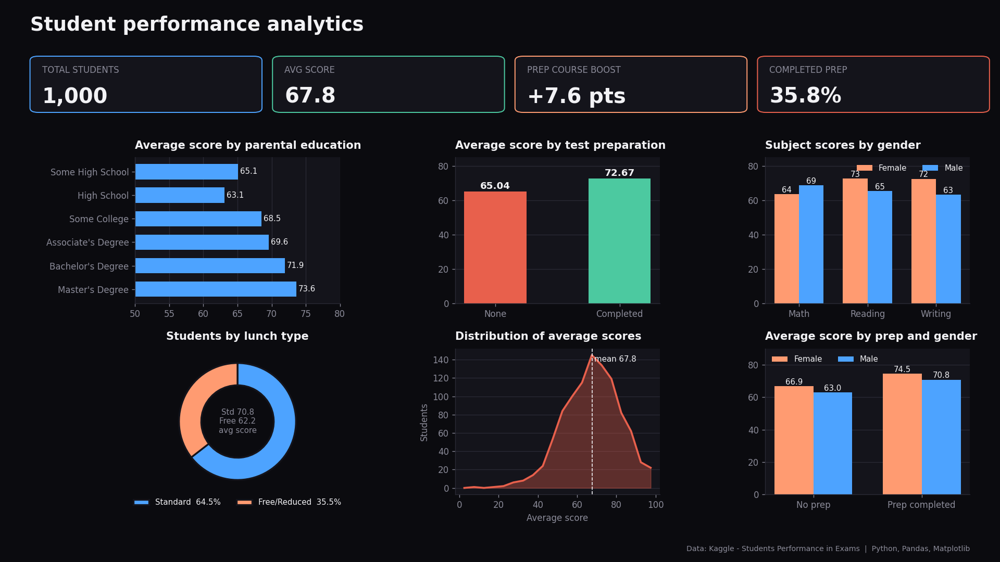

# Student Performance Analysis

Analysis of student exam scores using Python, Pandas and SQL (SQLite).

## Dataset
"Students Performance in Exams" from Kaggle. Each record has gender, parental education,
lunch type, test preparation course status, and math, reading and writing scores.

## What I did
1. Loaded the CSV with Pandas and cleaned the column names.
2. Checked for missing values and duplicate rows.
3. Created an `average_score` column from the three subject scores.
4. Loaded the cleaned data into an SQLite database.
5. Wrote SQL queries (GROUP BY, ORDER BY, aggregate functions, a subquery) to answer questions about performance.

## Key findings
- The dataset has 1,000 records with no missing values and no duplicate rows.
- Students who completed the test preparation course scored about 7.6 points higher on average (72.67 vs 65.04).
- Average score rose with parental education: students whose parents hold a master's degree averaged 73.60, compared with 63.10 for high school.
- Students with a standard lunch averaged 70.84, versus 62.20 for free/reduced lunch.
- Female students scored higher in reading (72.61 vs 65.47) and writing (72.47 vs 63.31), while male students scored higher in math (68.73 vs 63.63).
- 40 students scored below 40 in math, and 526 students scored above the overall average.

## How to run
```
pip install pandas
python student_analysis.py
```
Place `StudentsPerformance.csv` in the same folder.

## Tools
Python, Pandas, SQL, SQLite
